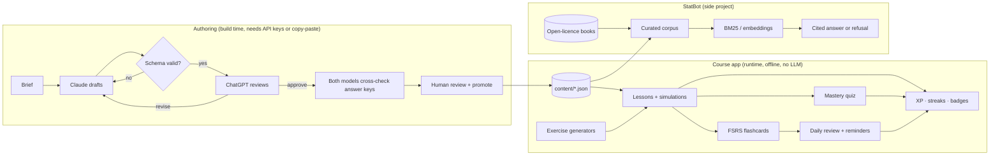

# statLearner project plan

## Goal

statLearner teaches the foundations of statistics in short daily sessions. It runs fully offline in a browser, with no LLM at runtime. Claude and ChatGPT help write the content beforehand. A side project, StatBot, answers statistics questions from curated sources only.

## What exists today (v0.1)

| Part | Status | Where |
|---|---|---|
| Course app (PWA) | 7 sessions, 28 exercise generators, 10 simulations, mastery quizzes, 63 flashcards | `app/` |
| Spaced repetition | FSRS-6 scheduler, interleaved review queue, mastery per session | `app/src/fsrs.js`, `app/src/srs.js` |
| Gamification | XP, levels, daily goal, streaks with freezes, 11 badges | `app/src/game.js` |
| Reminders | Daily calendar reminder (.ics), browser notifications | `app/src/reminders.js` |
| Offline | Service worker caches everything, including the vendored KaTeX math renderer | `app/sw.js` |
| Authoring pipeline | Claude drafts, ChatGPT reviews, Claude revises, both cross-check answer keys; manual copy-paste mode | `authoring/`, [AUTHORING.md](AUTHORING.md) |
| StatBot phase 0 | BM25 retrieval, cited extractive answers, refusals, eval set (97% hit@3) | `statbot/`, [STATBOT-PLAN.md](STATBOT-PLAN.md) |
| Research basis | 13 learning-science methods mapped to features | [LEARNING-DESIGN.md](LEARNING-DESIGN.md) |
| Tests | 70+ JavaScript tests, 7 Python tests, browser smoke test of every session | `tests/`, `statbot/tests/` |

## Architecture

## Roadmap

| Milestone | Content | Effort | Cost |
|---|---|---|---|
| **M1: Try it yourself** | Work through sessions 1-3 for a week; note confusing spots; tune the daily goal | 1 week of 15 min/day | $0 |
| **M2: Publish** | Enable GitHub Pages (Settings → Pages → Source: GitHub Actions); the included workflow deploys `app/` | 15 minutes | $0 |
| **M3: More sessions** | Sessions 8-10 via the pipeline: comparing two groups (brief included), chi-square tests, multiple regression; add the generators they propose | 1 evening per session | ~$2 per session in API fees |
| **M4: Personal FSRS** | Fit FSRS parameters to the learner's own review log after ~1,000 reviews | 1 weekend | $0 |
| **M5: StatBot phases 1-2** | Ingest open textbooks, add embeddings and a local 3B model with citation checks | 3-6 weekends | $0 |
| **M6 (optional)** | StatBot in the browser (BM25 in JavaScript), true push reminders (needs a small server), StatBot fine-tuning | as needed | $0-40 once; a push server costs ~$5/month |

## Minimum requirements and investment

| Part | Minimum to run | Recommended | One-off cost | Running cost |
|---|---|---|---|---|
| Course app | Any modern browser | Install as an app (PWA) on phone and laptop | $0 | $0 (GitHub Pages) |
| Development | Node.js 20+, Python 3.9+ | VS Code or any editor | $0 | $0 |
| Authoring with APIs | Anthropic and OpenAI API keys | Prepaid credit of $20 on each | ~$2 per session | - |
| Authoring without APIs | Claude and/or ChatGPT subscription | Manual mode in the CLI | $0 | ~$20/month per subscription (optional) |
| StatBot phase 0-1 | Any computer | - | $0 | $0 |
| StatBot phase 2 (local RAG) | 8 GB RAM, 10 GB free disk | 16 GB RAM or Apple Silicon | $0 | $0 (electricity) |
| StatBot phase 3 (fine-tune) | Rented 24 GB GPU (AWS `g6.xlarge` ~$0.80/h) | Spot instance, stop after each run | $10-40 | $0 |

**Recommendation:** spend nothing until M3. Then buy $20 of API credit per provider, or use manual mode with subscriptions you already have. Rent a GPU only if StatBot phase 2 shows that fine-tuning is needed.

## Decisions for you

1. **Which book?** The course maps to *OpenIntro Statistics* (4th ed., free, CC BY-SA 3.0). If you meant another book, change `book` in `app/content/course.json` and each session's `bookRef`. If the book covers different topics, for example *An Introduction to Statistical Learning*, add sessions with the pipeline.
2. **Publish publicly or keep private?** GitHub Pages serves the app from a public URL (free for public repositories).
3. **Language:** content is in English. The pipeline can produce a German version from translated briefs.

## Risks

| Risk | Mitigation |
|---|---|
| Wrong statistics in LLM-written content | Two-model review, blind answer-key cross-check, human checklist, schema validation, generator tests |
| Copyright | Original wording only; briefs paraphrase; StatBot ingests only openly licensed text (`statbot/sources.json`) |
| Learners lose progress (localStorage) | Export/import in Settings; a later sync option is possible |
| Streak pressure demotivates | Streak freezes, honest-grade-neutral XP, no leaderboards |
| Browser notifications unreliable | Calendar reminder (.ics) as the primary reminder |
